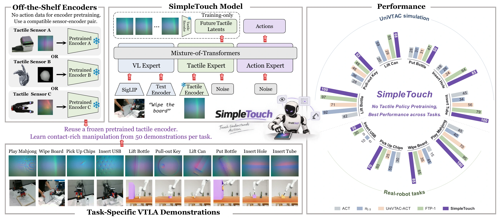

<div align="center">
  <h1>SimpleTouch</h1>
  <h3>Can Vision-Language-Action Models Master Contact-Rich Manipulation<br>Without Tactile Policy Pretraining?</h3>

  <p>
    Chen Yang<sup>1,2,*</sup> · Linzhe Shi<sup>2,*</sup> ·
    Changjie Wu<sup>2</sup> · Hang Zhang<sup>2</sup> · Ronghan Chen<sup>2</sup><br>
    Lingjun Zhang<sup>1,2</sup> · Xu Hu<sup>2,3</sup> · Mu Xu<sup>2</sup> ·
    Jiansheng Fan<sup>1</sup> · Chen Wang<sup>1,†</sup>
  </p>
  <p>
    <sup>1</sup>Tsinghua University &nbsp;&nbsp;
    <sup>2</sup>Amap, Alibaba Group &nbsp;&nbsp;
    <sup>3</sup>Hong Kong Polytechnic University<br>
    <sup>*</sup>Equal contribution &nbsp;&nbsp;
    <sup>†</sup>Corresponding author
  </p>
  <p>
    <a href="https://simpletouch-robot.github.io/"></a>
    <a href="https://arxiv.org/pdf/2610.02784"></a>
    <a href="https://arxiv.org/abs/2610.02784"></a>
    <a href="https://huggingface.co/cyang203912/SimpleTouch"></a>
  </p>
</div>



SimpleTouch adds a tactile expert to π0.5 and learns contact-rich manipulation from task demonstrations, without tactile policy pretraining.

## ⚙️ Environment Setup

Install [uv](https://docs.astral.sh/uv/getting-started/installation/) and the policy environment on Linux (Python 3.11 and an NVIDIA GPU):

```bash
bash requirements/install.sh embodied --model openpi --env policy-only
source .venv/bin/activate
```

Download the [T3-large Mini encoder](https://huggingface.co/datasets/alanz-mit/FoundationTactile/tree/main/models/t3_large) and the [PaliGemma tokenizer](https://github.com/Physical-Intelligence/openpi/blob/main/src/openpi/models/tokenizer.py):

```bash
hf download alanz-mit/FoundationTactile --repo-type dataset \
  --include 'models/t3_large/encoders/mini.pth' 'models/t3_large/trunk.pth' \
  --local-dir assets/t3
curl --fail --location --retry 3 \
  https://storage.googleapis.com/big_vision/paligemma_tokenizer.model \
  --output assets/paligemma_tokenizer.model
export SIMPLETOUCH_T3_PATH="$(realpath assets/t3/models/t3_large)"
export SIMPLETOUCH_TOKENIZER_PATH="$(realpath assets/paligemma_tokenizer.model)"
```

## 📊 Evaluation

Evaluate SimpleTouch with our [released checkpoints](https://huggingface.co/cyang203912/SimpleTouch). The launcher downloads the selected 20k checkpoint on first use.

Install [Conda](https://docs.conda.io/projects/conda/en/latest/user-guide/install/index.html), [Git LFS](https://git-lfs.com/) and GCC/G++ 11 on Linux x86_64. From the SimpleTouch repository root, create a separate simulator environment with pinned UniVTAC, Isaac Sim 4.5, Isaac Lab, TacEx and cuRobo versions:

```bash
conda activate base
export SIM_ROOT="$(realpath -m ../simpletouch-univtac)"
SIM_GPU=0
SIM_ARCH=$(nvidia-smi --id="$SIM_GPU" --query-gpu=compute_cap \
  --format=csv,noheader | tr -d '. ')
bash requirements/install_univtac.sh \
  --prefix "$SIM_ROOT" --gpu "$SIM_GPU" --cuda-arch "$SIM_ARCH" \
  --accept-isaac-eula
source "$SIM_ROOT/env.sh"
```

Use an idle build GPU and pass `--accept-isaac-eula` only if you accept NVIDIA's Isaac Sim license. Installation downloads the simulation assets and compiles CUDA extensions; `--jobs N` controls build parallelism (default: 4). Completed stages are reused when re-running with unchanged inputs. Evaluation also needs `vulkaninfo`, `ffmpeg` and `ss` on the host. See the [UniVTAC installation guide](https://github.com/univtac/UniVTAC/blob/main/docs/Installation.md) for additional system requirements.

On Debian/Ubuntu containers, prepare the private Vulkan/EGL and X11 libraries without changing the system driver:

```bash
bash scripts/univtac/setup_nvidia_vulkan.sh
export VULKAN_RUNTIME_ENV="$(realpath .runtime/vulkan/env.sh)"
source "$VULKAN_RUNTIME_ENV"
```

Return to the policy environment and select a task. The paths from `env.sh` keep the simulator separate from the policy:

```bash
source .venv/bin/activate
export TASK=insert_hole
```

Evaluate on one GPU:

```bash
GPU_ID=0 bash scripts/simpletouch/evaluate_univtac.sh
```

For a short smoke test, prefix the command with `TOTAL_NUM=3`. To use a downloaded checkpoint, also set `CKPT_PATH=/path/to/insert_hole/global_step_20000`.

Or split the same 100 episodes across multiple GPUs and merge their results into one directory:

```bash
SIMPLETOUCH_EVAL_GPUS=0,1,2,3 bash scripts/simpletouch/evaluate_univtac.sh
```

Available tasks: `lift_bottle`, `pull_out_key`, `lift_can`, `put_bottle_in_shelf`, `insert_hole`, `insert_tube`. Insert Hole and Insert Tube use H25; the others use H50. Temporal ensembling is off. Results go to `results/UniVTAC/SimpleTac/<task>/<run-id>`; set `SIMPLETOUCH_EVAL_ROOT` to change the output root. The public layout contains `video/worker_0/<seed>_<result>.mp4`, `metadata/worker_0.json`, `metadata.json` and `log.log`. Videos are stored once in `.eval_runs/`; the public video entries are relative symbolic links to those originals. Per-process scenes, metadata and logs also stay in `.eval_runs/`. Keep that directory when moving or archiving a run. For resumed evaluation, use the [managed evaluator](scripts/univtac/eval_simpletac_managed.py).

## 🔥 Training

### UniVTAC example

The [default recipe](examples/sft/config/simpletac_univtac.yaml) trains for 20,000 steps on episodes 0–49 with 8 GPUs × 8 samples. Use the [Isaac Sim 4.5 UniVTAC demonstrations](https://github.com/univtac/UniVTAC#data-collection), arranging the selected episodes as `<data-root>/<task>/clean/0.hdf5` through `49.hdf5`. Keep the T3 and tokenizer paths set above.

For `insert_hole`, compute normalization statistics and cache future tactile features before starting training:

```bash
export SIMPLETOUCH_TASK=insert_hole
export SIMPLETOUCH_DATA_ROOT=/path/to/UniVTAC/dataset
export SIMPLETOUCH_NORM_STATS_PATH=/path/to/insert_hole/norm_stats.json
export SIMPLETOUCH_BASE_MODEL_PATH="$(pwd)/assets/pi05_base_pytorch"
export SIMPLETOUCH_FUTURE_CACHE_ROOT=/path/to/t3_cache

python scripts/univtac/recompute_norm_stats.py \
  --task "$SIMPLETOUCH_TASK" \
  --data-root "$SIMPLETOUCH_DATA_ROOT" \
  --episode-start 0 --episode-end 49 \
  --output "$SIMPLETOUCH_NORM_STATS_PATH"
```

Download the official [π0.5 base checkpoint](https://github.com/Physical-Intelligence/openpi#base-models) and convert it once to this repository's native PyTorch layout. Skip this step if you already have a converted base model:

```bash
uv pip install 'jax[cpu]==0.5.3' 'orbax-checkpoint==0.11.13' 'gcsfs==2025.3.0'
python -c "import gcsfs; gcsfs.GCSFileSystem(token='anon').get('openpi-assets/checkpoints/pi05_base/*', 'assets/pi05_base/', recursive=True)"
JAX_PLATFORMS=cpu python -m rlinf.utils.ckpt_convertor.openpi.jax2new \
  --input-model assets/pi05_base \
  --input-norm-stats "$SIMPLETOUCH_NORM_STATS_PATH" \
  --output-model "$SIMPLETOUCH_BASE_MODEL_PATH" \
  --output-norm-stats "$SIMPLETOUCH_BASE_MODEL_PATH/norm_stats.json"
```

Build the future-touch cache, then launch training:

```bash
python scripts/univtac/cache_t3_latents.py \
  --task "$SIMPLETOUCH_TASK" \
  --data-root "$SIMPLETOUCH_DATA_ROOT" \
  --output-root "$SIMPLETOUCH_FUTURE_CACHE_ROOT" \
  --tactile-encoder "$SIMPLETOUCH_T3_PATH" \
  --tactile-preprocess-profile univtac_task_rgb_train_ep0_49_r256_cc224_v1 \
  --episode-start 0 --episode-end 49 --pool-grid 6

SIMPLETOUCH_NUM_GPUS=8 bash scripts/simpletouch/train_univtac.sh
```

For another task, change `SIMPLETOUCH_TASK` and the corresponding paths. Training requires the generated `<cache-root>/<task>/manifest.json`; it does not build the cache automatically. Set `SIMPLETOUCH_OUTPUT_ROOT` to change the default `outputs/` directory.

## ⚖️ License

This repository retains the [Apache-2.0 license](LICENSE). Third-party models, datasets, simulators, and dependencies have their own licenses and access requirements.

## 🤝 Acknowledgements

We thank the authors and maintainers of [RLinf](https://github.com/RLinf/RLinf), [OpenPI](https://github.com/Physical-Intelligence/openpi), [T3](https://github.com/alanzjl/t3), and [UniVTAC](https://github.com/univtac/UniVTAC).

## 📝 Citation

Please cite SimpleTouch as follows.

```bibtex
@misc{yang2026simpletouchvisionlanguageactionmodelsmaster,
  title={SimpleTouch: Can Vision-Language-Action Models Master Contact-Rich Manipulation Without Tactile Policy Pretraining?},
  author={Chen Yang and Linzhe Shi and Changjie Wu and Hang Zhang and Ronghan Chen and Lingjun Zhang and Xu Hu and Mu Xu and Jiansheng Fan and Chen Wang},
  year={2026},
  eprint={2610.02784},
  archivePrefix={arXiv},
  primaryClass={cs.RO},
  url={https://arxiv.org/abs/2610.02784},
}
```
