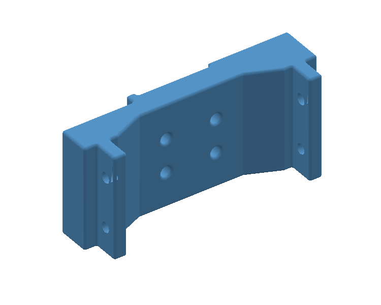
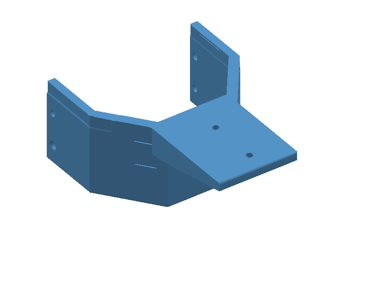
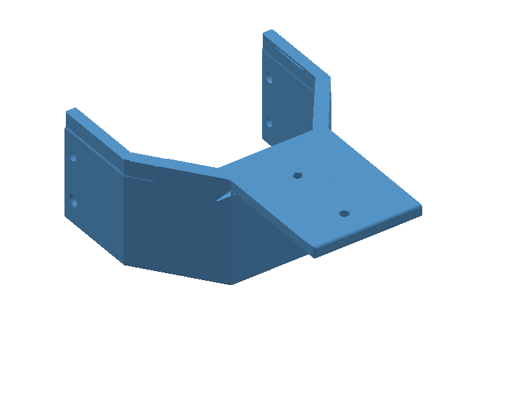
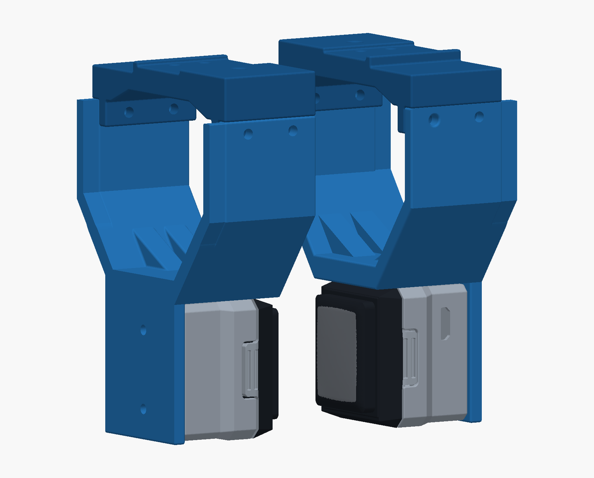
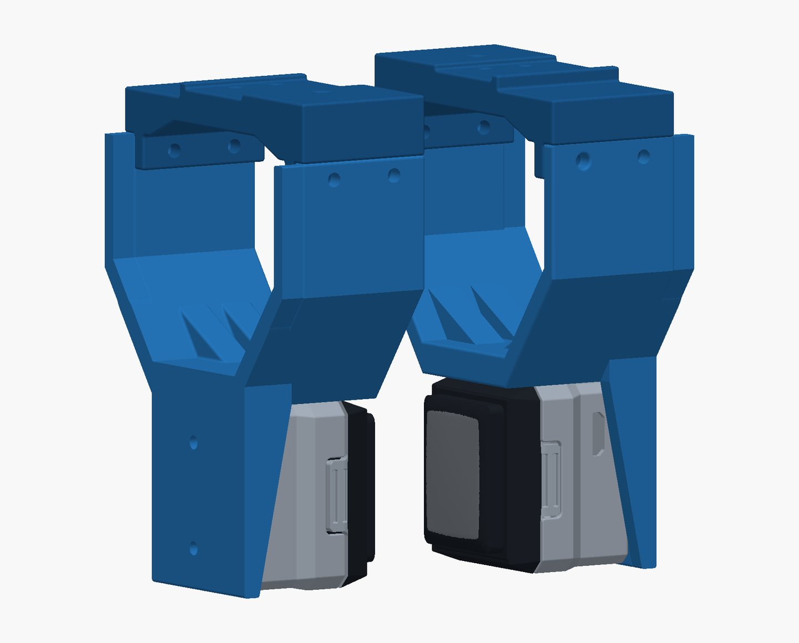
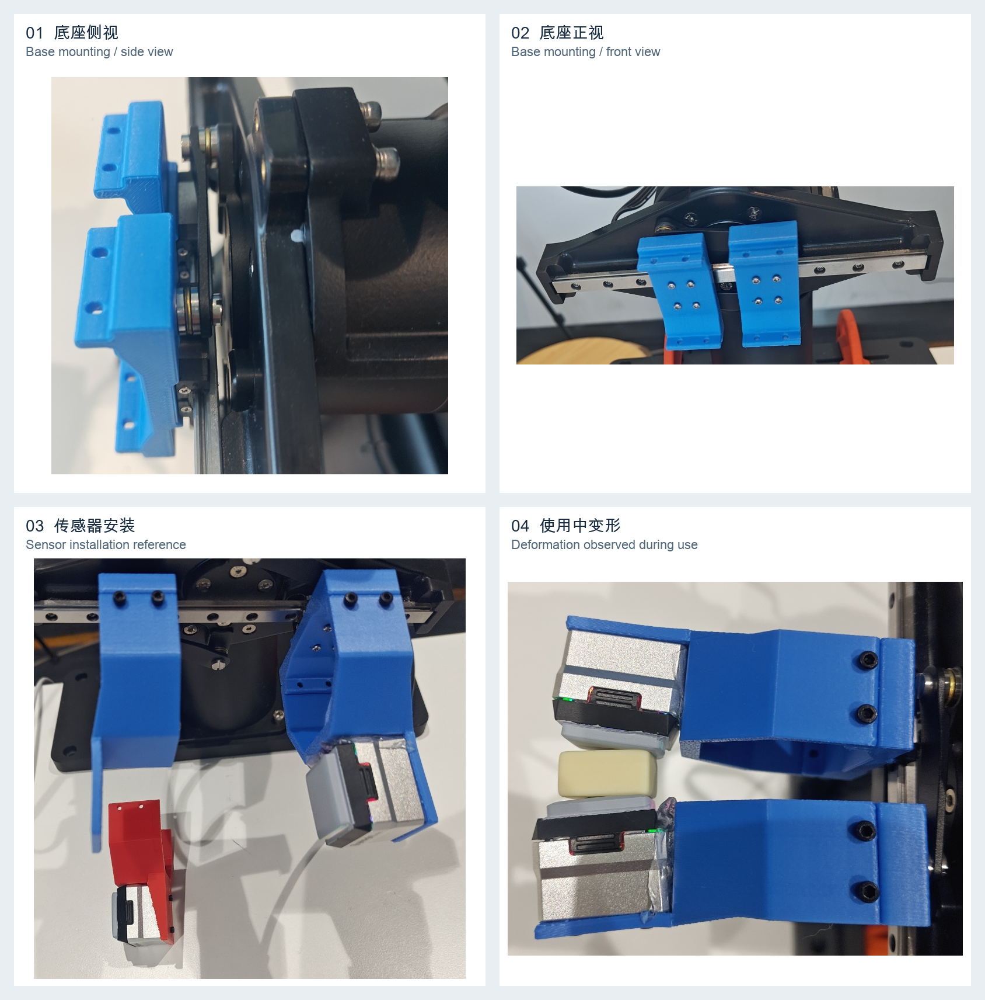

# GelSight Mini 夹爪打印结构件 / Printable Gripper Parts

本包包含夹爪底座，以及右侧、左侧三角加强板的两版结构件。
This package contains the gripper base and the right- and left-reinforced bracket variants.

| 结构预览 / Preview | 文件 / File | 内容 / Part | 尺寸 / Size (mm) |
| --- | --- | --- | --- |
|  | [gelsight_gripper_base.stl](../gelsight_gripper_base.stl) | 原始夹爪底座 / Original gripper base | 56 × 16.25 × 24.5 |
|  | [gelsight_gripper_right_v9.stl](../gelsight_gripper_right_v9.stl) | 右侧三角板结构件 / Right-reinforced bracket | 56 × 74.75 × 28.5 |
|  | [gelsight_gripper_left_v10.stl](../gelsight_gripper_left_v10.stl) | 左侧三角板结构件 / Left-reinforced bracket | 56 × 74.75 × 28.5 |

## 材料清单 / Bill of materials

以下为本项目装配所需的紧固件清单。
Fasteners specified for this project assembly:

| 配件 / Item | 数量 / Quantity | 用途 / Application |
| --- | --- | --- |
| M3 热熔螺母 / M3 heat-set threaded insert | 2 | 嵌入底座，用于连接 Piper 末端夹爪电机驱动结构 / Embedded in the base to connect it to the Piper end-effector gripper motor drive assembly |
| M2.5 螺丝 / M2.5 screw | 8 | 夹爪连接底座 / Gripper-to-base connection |
| M2 螺丝 / M2 screw | 8 | 底座连接末端 / Base-to-end-effector connection |
| M2 螺丝 / M2 screw | 4 | 固定 GelSight Mini / Securing the GelSight Mini |

打印件见上方文件清单。
Printed parts are listed above.

## 安装与使用说明 / Assembly and use guide

### 装配渲染示意 / Assembly rendering

| 正面斜视 / Front oblique view | 背面斜视 / Rear oblique view |
| --- | --- |
|  |  |

以上两图使用本包底座、V9/V10 夹爪 STL 和 [GelSight 官方外壳 CAD](https://github.com/gelsightinc/gsrobotics#cad-models) 进行三维装配渲染。底座与夹爪按连接孔对齐，传感器安装面贴合支架内侧，两个触觉接触面相对。图中省略 Piper 电机、紧固件和线缆；开合间距及材质颜色仅作展示。

These 3D renderings use the supplied base and V9/V10 bracket STL files together with the [official GelSight shell CAD](https://github.com/gelsightinc/gsrobotics#cad-models). The base and bracket mounting holes are aligned, the sensor mounting faces sit against the inner bracket plates, and the tactile surfaces face each other. The Piper motor, fasteners, and cables are omitted; the opening and material colors are illustrative.

下图汇总底座安装、传感器安装及使用中观察到的变形。照片用于说明装配位置和改版背景，拍摄时的结构不代表本包 V9/V10 加固版的最终形态。

The photos below show base mounting, sensor installation, and deformation observed during use. They illustrate assembly positions and the motivation for the revisions; the photographed parts do not represent the final V9/V10 reinforced geometry in this package.

1. **底座侧视（图 01）**：展示蓝色底座与 Piper 末端夹爪电机驱动结构的相对位置。

   **Base mounting, side view (01):** shows the blue base relative to the Piper end-effector gripper motor drive assembly.

2. **底座正视（图 02）**：展示两侧底座的安装位置与固定孔位。

   **Base mounting, front view (02):** shows the positions and mounting holes of both bases.

3. **传感器安装（图 03）**：右侧蓝色支架展示 GelSight Mini 的安装位置。

   **Sensor installation (03):** the blue bracket on the right shows the GelSight Mini mounting position.

4. **使用观察（图 04）**：展示使用过程中观察到的夹爪变形。

   **Inspection during use (04):** shows gripper deformation observed during use.

## 改动记录 / Design changes

1. **第一版部署测试**：直接使用原始结构件进行部署测试。

   **Initial deployment and testing:** used the original structural parts directly for deployment testing.

2. **使用中发现的问题**：长时间使用后，夹爪会出现变形。

   **Observed issue:** the gripper deformed after prolonged use.

3. **加固改版**：针对上述问题，增加连接处加固并加厚结构；本包提供右侧三角加强板 V9 和左侧三角加强板 V10。

   **Reinforcement revision:** added reinforcement at the connections and increased structural thickness in response. This package provides the V9 right-side and V10 left-side reinforcement variants.

## 致谢 / Acknowledgements

感谢 [AnyTouch2](https://github.com/GeWu-Lab/AnyTouch2) 项目及作者冯若轩提供机械结构设计源文件。这些源文件为本项目的夹爪部署测试与后续结构改进提供了基础。本项目在原始设计基础上，针对长期使用中出现的夹爪变形问题，增加了连接处加固并加厚结构。感谢作者对开源社区的分享与支持。

We thank the [AnyTouch2](https://github.com/GeWu-Lab/AnyTouch2) project and its author, Ruoxuan Feng (冯若轩), for providing the mechanical design source files. These files formed the basis of our gripper deployment tests and subsequent structural improvements. Building on the original design, we reinforced the connections and increased structural thickness to address deformation observed during prolonged use. We appreciate the author's sharing and support of the open-source community.

## 许可证 / License

本项目的结构加固改动及随附文档沿用 SimpleTouch 的 **Apache License 2.0**，详见 [LICENSE](LICENSE)。原始结构件保留原作者的权利及适用许可；本声明不重新许可第三方原始材料。

The structural reinforcement modifications and accompanying documentation in this project follow SimpleTouch's **Apache License 2.0**; see [LICENSE](LICENSE). The original structural parts retain their authors' rights and applicable license terms. This notice does not relicense third-party original materials.
